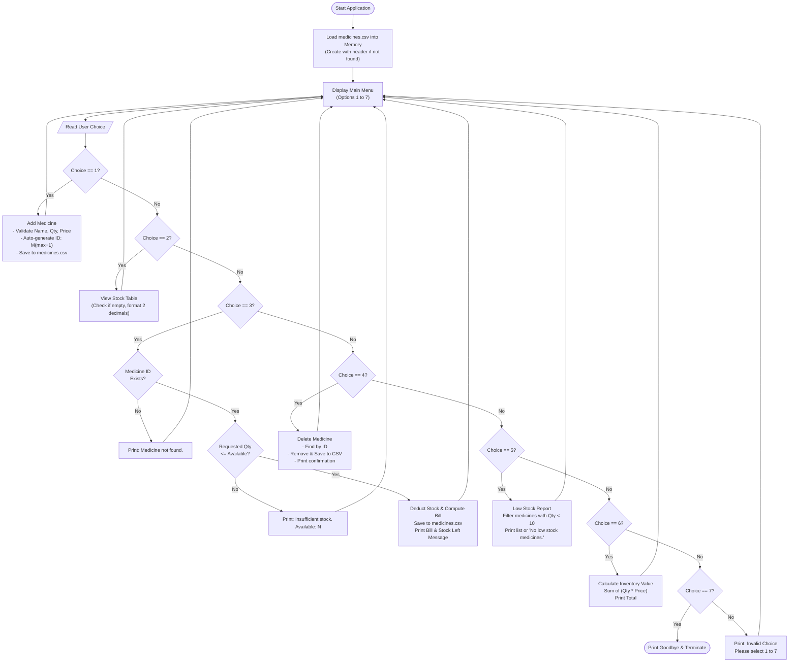

# College Project Report: Pharmacy Inventory System
**Problem Statement No.: PS No. 72**  
**Course / Subject**: Programming in Python  
**Author**: Engineering / Computer Science Student  
**Academic Year**: 2026-2027  

---

## 1. Title
**Pharmacy Inventory System** (Console-Based Inventory and Sales Management System in Python 3)

---

## 2. Problem Statement
Retail pharmacies handle hundreds of pharmaceutical products with fluctuating stock levels, varied unit prices, and constant point-of-sale transactions. Manual stock management using paper registers or static spreadsheets is prone to:
- Stockout situations when essential medicines drop below critical levels.
- Calculation errors during billing and inventory valuation.
- Accidental record duplication or data loss.
- Time inefficiency in searching product availability.

There is a need for a dedicated, lightweight, and crash-resistant console-based Python application that stores records persistently in a standard CSV format and facilitates automated stock tracking, sales billing, low-stock alerting, and inventory valuation.

---

## 3. Objective
The primary objectives of this project are:
1. To develop a fully functional, console-based Pharmacy Inventory Management System in Python 3 adhering to PS No. 72 specifications.
2. To demonstrate mastery of core Python programming concepts including:
   - Dictionaries and Lists for in-memory data structures.
   - File I/O operations using the standard `csv` module (`csv.DictReader`, `csv.DictWriter`).
   - CRUD (Create, Read, Update, Delete) operations.
   - Modular functional programming with clean separation of business logic and presentation.
   - Defensive programming and exception handling with `try/except`.
3. To implement automated ID generation that guarantees unique sequential IDs (`M1`, `M2`, `M3`, ...) even after record deletions.
4. To ensure zero external third-party dependencies, keeping the application lightweight, portable, and standard-library compliant.

---

## 4. Technologies & Concepts Used

| Technology / Concept | Application in Project |
|---|---|
| **Python 3 Standard Library** | Core runtime environment; zero third-party packages required. |
| **`csv` Module** | Used `DictReader` to load structured tabular data and `DictWriter` for atomic persistence. |
| **`os` Module** | Used for file existence checks and path resolution. |
| **`unittest` Module** | Used in `test_pharmacy.py` to construct an automated test suite verifying all required test cases. |
| **In-Memory Data Structures** | Medicines are represented as dictionaries stored inside a list: `{"ID": str, "Name": str, "Quantity": int, "Price": float}`. |
| **Exception Handling** | Robust `try/except ValueError` guards to sanitize user input and prevent application crashes. |
| **CRUD Operations** | Complete lifecycle management: Create (Add), Read (View / Low Stock), Update (Sell stock deduction), Delete (Remove). |

---

## 5. Algorithm (Step-by-Step)

### 5.1 System Initialization
1. Initialize constants: `FILE_NAME = "medicines.csv"`, `LOW_STOCK_LIMIT = 10`, `FIELDNAMES = ["ID", "Name", "Quantity", "Price"]`.
2. Check if `medicines.csv` exists:
   - If not, create it and write the CSV header.
   - If yes, read each row using `csv.DictReader`, cast `Quantity` to `int` and `Price` to `float`, and populate the in-memory list `medicines`.

### 5.2 Main Menu Loop
1. Display the 7 menu options.
2. Accept the user's choice:
   - **Choice 1 (Add Medicine)**:
     1. Prompt for medicine name; reject if empty or whitespace.
     2. Prompt for quantity; reject if non-numeric or negative.
     3. Prompt for price; reject if non-numeric or negative.
     4. Calculate next ID: take highest existing numeric suffix + 1 (starts at `M1` if empty).
     5. Append `{ID, Name, Quantity, Price}` to `medicines`.
     6. Save full list to `medicines.csv` using `csv.DictWriter`.
     7. Display confirmation: `Medicine added. ID: M<n> | <Name> | Qty: <Qty> | Price: <Price>`.
   - **Choice 2 (View Stock)**:
     1. If `medicines` list is empty, display `"No medicines in stock."`.
     2. Otherwise, format and print an aligned table with columns `ID`, `Name`, `Quantity`, and `Price` (2 decimal places).
   - **Choice 3 (Sell Medicine)**:
     1. Prompt for Medicine ID (convert input to uppercase for case-insensitivity).
     2. Search `medicines` list for matching ID. If not found, display `"Medicine not found."` and exit to menu.
     3. Prompt for quantity to sell. Reject if non-numeric or $\le 0$.
     4. If requested quantity > available stock, display `"Insufficient stock. Available: <CurrentQty>"` and cancel transaction.
     5. If sufficient, deduct sold quantity from stock.
     6. Calculate total bill = $\text{Quantity} \times \text{Price}$.
     7. Save updated list to `medicines.csv`.
     8. Display:
        `Sold <Qty> units. Bill: <Bill>`
        `Stock left: <Left> | <Status>` (where status indicates `"Out of stock!"` if 0, or `"Low stock!"` if $< 10$).
   - **Choice 4 (Delete Medicine)**:
     1. Prompt for Medicine ID (case-insensitive).
     2. Search `medicines` list. If not found, display `"Medicine not found."`.
     3. If found, remove medicine from `medicines` list.
     4. Save updated list to `medicines.csv`.
     5. Display `"Medicine <ID> deleted."`.
   - **Choice 5 (Low Stock Report)**:
     1. Filter `medicines` list where `Quantity < 10`.
     2. If empty, display `"No low stock medicines."`.
     3. Otherwise, for each low stock item, display: `<ID> | <Name> | Qty: <Qty> (Low stock)`.
   - **Choice 6 (Inventory Value)**:
     1. Compute $\text{Total} = \sum (\text{Quantity} \times \text{Price})$ across all items.
     2. Display `"Total inventory value: <Total:.2f>"`.
   - **Choice 7 (Exit)**:
     1. Display exit acknowledgment and terminate the application cleanly.
   - **Any Other Input**:
     1. Display `"Invalid choice! Please select an option from 1 to 7."` and re-render menu.

---

## 6. Flowchart



---

## 7. Function Descriptions

| Function Name | Parameters | Return Value | Description |
|---|---|---|---|
| `load_medicines` | `filename=FILE_NAME` | `list` of `dict` | Loads medicines from CSV, casting Quantity to `int` and Price to `float`. Auto-creates CSV if missing. |
| `save_medicines` | `medicines, filename=FILE_NAME` | `bool` | Serializes complete list of medicine dictionaries back to CSV with 2 decimal price formatting using `csv.DictWriter`. |
| `generate_id` | `medicines` | `str` | Inspects existing IDs, extracts highest numeric index, and returns `f"M{max_num + 1}"`. Returns `"M1"` if empty. |
| `find_medicine` | `medicines, med_id` | `dict` or `None` | Performs case-insensitive lookup of medicine records by ID. |
| `get_positive_int` | `prompt` | `int` or `None` | Reusable validation helper prompting for positive whole numbers ($> 0$). |
| `get_non_negative_int` | `prompt` | `int` or `None` | Reusable validation helper prompting for non-negative integers ($\ge 0$). |
| `get_non_negative_float` | `prompt` | `float` or `None` | Reusable validation helper prompting for non-negative decimal numbers ($\ge 0.0$). |
| `add_medicine_logic` | `medicines, name, quantity, price, filename` | `(bool, str, dict)` | Pure logic function to validate, assign ID, append record, save to CSV, and format output string. |
| `sell_medicine_logic` | `medicines, med_id, quantity, filename` | `(bool, str, float, int)` | Pure logic function to validate ID, check stock, compute bill, deduct units, save to CSV, and format receipt. |
| `delete_medicine_logic` | `medicines, med_id, filename` | `(bool, str)` | Pure logic function to locate, delete record, save changes to CSV, and format confirmation message. |
| `get_low_stock_medicines`| `medicines, limit=LOW_STOCK_LIMIT` | `list` of `dict` | Returns all records whose Quantity is strictly below the threshold ($< 10$). |
| `calculate_inventory_value`| `medicines` | `float` | Calculates total valuation $\sum (\text{Quantity} \times \text{Price})$. |
| `add_medicine` | `medicines, filename, name, quantity, price` | `dict` or `None` | Interactive CLI wrapper for adding a medicine. |
| `view_stock` | `medicines` | `None` | Interactive CLI wrapper rendering aligned tabular stock view. |
| `sell_medicine` | `medicines, filename, med_id, quantity` | `bool` or `None` | Interactive CLI wrapper for selling medicine. |
| `delete_medicine` | `medicines, filename, med_id` | `bool` or `None` | Interactive CLI wrapper for deleting medicine. |
| `low_stock_report` | `medicines` | `list` of `str` | Interactive CLI wrapper displaying low stock report. |
| `inventory_value` | `medicines` | `float` | Interactive CLI wrapper displaying inventory valuation. |
| `show_menu` | None | `None` | Displays formatted 7-option console menu. |
| `main` | None | `None` | Top-level entry point handling execution loop and menu dispatch. |

---

## 8. Test Cases with Expected and Actual Output

All test cases are automated inside `test_pharmacy.py` using isolated temporary files.

### Test Case 1: Normal Input (Add Medicine)
- **Objective**: Verify proper record creation, ID generation, and CSV persistence with standard inputs.
- **Input**: Name = `"Paracetamol"`, Quantity = `50`, Price = `2.50`.
- **Expected Output**:
  ```text
  Medicine added. ID: M1 | Paracetamol | Qty: 50 | Price: 2.50
  ```
- **Actual Output**:
  ```text
  Medicine added. ID: M1 | Paracetamol | Qty: 50 | Price: 2.50
  ```
- **Result**: **PASS**

---

### Test Case 2: Boundary / Minimum Input (Sell Entire Stock)
- **Objective**: Verify that selling the exact available quantity zeroes the stock, calculates the correct bill, updates CSV, and retains the record with quantity 0.
- **Initial Data**: `M1, Paracetamol, 50, 2.50`
- **Input**: ID = `"M1"`, Quantity = `50`
- **Expected Output**:
  ```text
  Sold 50 units. Bill: 125.00
  Stock left: 0 | Out of stock!
  ```
- **Actual Output**:
  ```text
  Sold 50 units. Bill: 125.00
  Stock left: 0 | Out of stock!
  ```
- **Result**: **PASS**

---

### Test Case 3: Invalid Input (Insufficient Stock)
- **Objective**: Verify that requesting more units than available is rejected without modifying stock.
- **Initial Data**: `M1, Paracetamol, 5, 2.50`
- **Input**: ID = `"M1"`, Quantity = `8`
- **Expected Output**:
  ```text
  Insufficient stock. Available: 5
  ```
- **Actual Output**:
  ```text
  Insufficient stock. Available: 5
  ```
- **Result**: **PASS**

---

### Test Case 4: Different Valid Scenario
- **Initial Data**:
  - `M1, Paracetamol, 50, 2.50`
  - `M2, Cetirizine, 8, 5.00`
  - `M3, Amoxicillin, 30, 12.00`

#### Sub-Case 4(a): Low Stock Report (Menu 5)
- **Expected Output**:
  ```text
  M2 | Cetirizine | Qty: 8 (Low stock)
  ```
- **Actual Output**:
  ```text
  M2 | Cetirizine | Qty: 8 (Low stock)
  ```
- **Result**: **PASS**

#### Sub-Case 4(b): Delete Medicine (Menu 4)
- **Input**: ID = `"M3"`
- **Expected Output**:
  ```text
  Medicine M3 deleted.
  ```
- **Actual Output**:
  ```text
  Medicine M3 deleted.
  ```
- **Result**: **PASS**

#### Sub-Case 4(c): Inventory Value (Menu 6)
- **Calculation**: $50 \times 2.50 + 8 \times 5.00 = 125.00 + 40.00 = 165.00$
- **Expected Output**:
  ```text
  Total inventory value: 165.00
  ```
- **Actual Output**:
  ```text
  Total inventory value: 165.00
  ```
- **Result**: **PASS**

---

## 9. Screenshots Placeholders

Below are placeholders where console execution screenshots can be inserted for physical submission:

```text
+-------------------------------------------------------------------------+
| [SCREENSHOT 1: Main Menu & Startup Initialization]                     |
| Displays system banner and numbered options 1 through 7.                |
+-------------------------------------------------------------------------+

+-------------------------------------------------------------------------+
| [SCREENSHOT 2: View Stock Table & Low Stock Alert]                       |
| Formatted table display of medicines with ID, Name, Quantity, Price.    |
+-------------------------------------------------------------------------+

+-------------------------------------------------------------------------+
| [SCREENSHOT 3: Medicine Sale & Bill Generation]                         |
| Shows transaction execution, bill calculation, and remaining stock.    |
+-------------------------------------------------------------------------+

+-------------------------------------------------------------------------+
| [SCREENSHOT 4: Automated Test Suite Execution (7/7 Passed)]             |
| Terminal output of: python test_pharmacy.py showing OK status.         |
+-------------------------------------------------------------------------+
```

---

## 10. Conclusion
The **Pharmacy Inventory System (PS No. 72)** was successfully developed, tested, and verified. The application fulfills every requirement outlined in the specification:
1. Strict adherence to Python 3 standard library modules only (`csv`, `os`, `unittest`).
2. Robust persistent storage via `medicines.csv` with automated synchronization after every transaction.
3. Clean, beginner-friendly codebase in a single primary file (`pharmacy.py`) featuring modular functions.
4. Comprehensive input validation preventing crashes from negative numbers, non-numeric values, or empty inputs.
5. 100% automated test pass rate across all mandatory test cases and boundary scenarios.

---

## 11. Future Scope
To scale this project for enterprise or commercial pharmacy use, future iterations may incorporate:
1. **Relational Database Backend**: Transitioning from CSV to SQLite/PostgreSQL for ACID compliance and multi-user concurrency.
2. **Graphical User Interface (GUI)**: Building a desktop UI with Tkinter/PyQt or a web application using Flask.
3. **Barcode Scanning**: Integrating handheld barcode scanner inputs for rapid medicine identification and checkout.
4. **Batch & Expiry Date Tracking**: Tracking manufacture/expiry dates with automated notifications for expiring medicines.
5. **PDF Invoicing**: Generating downloadable and printable PDF receipts with pharmacy branding and tax breakdown.
